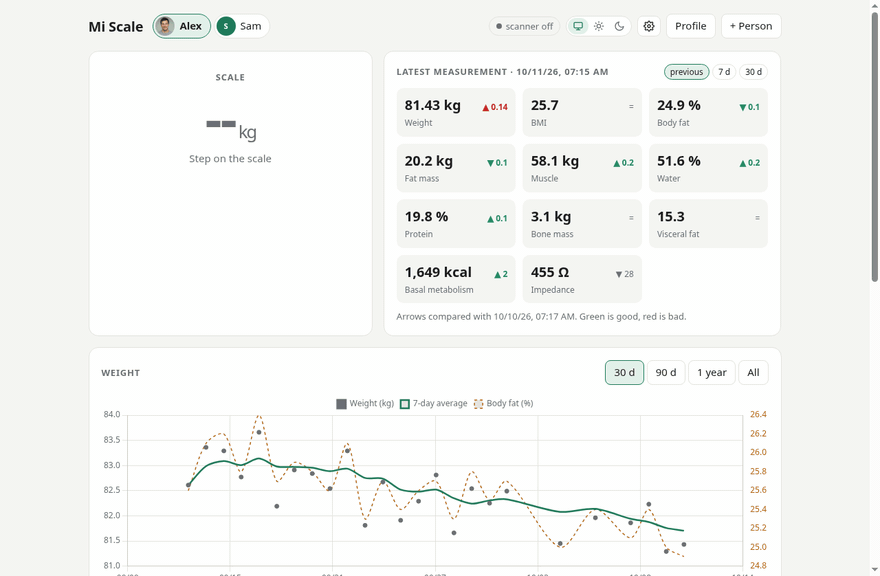
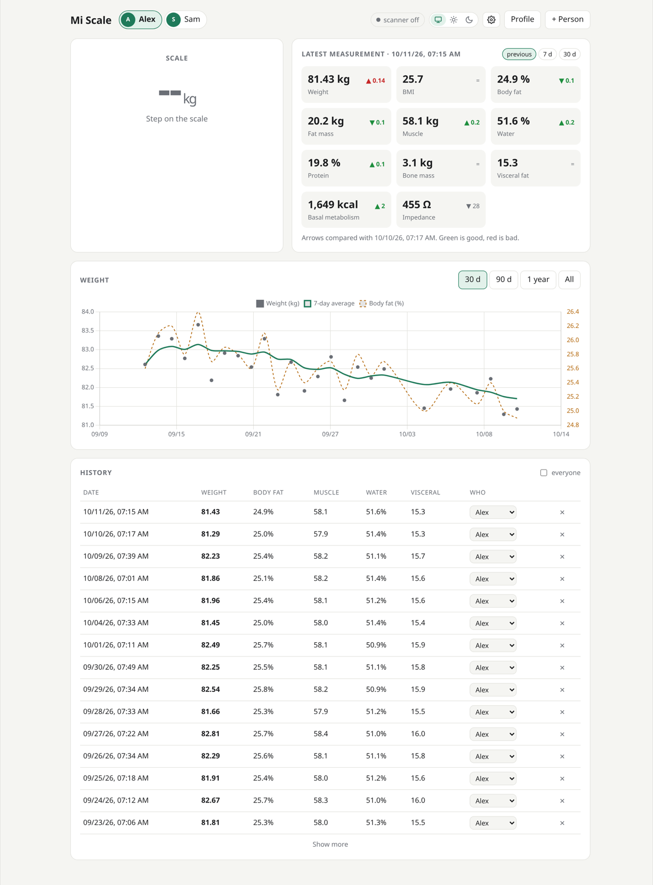
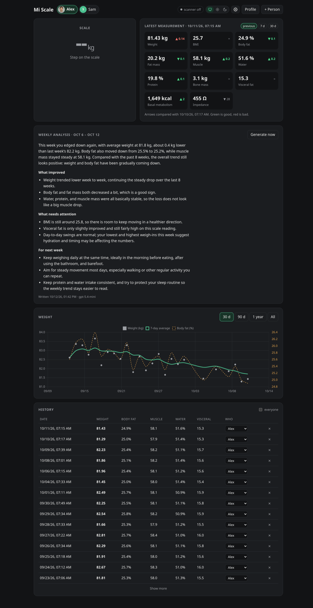
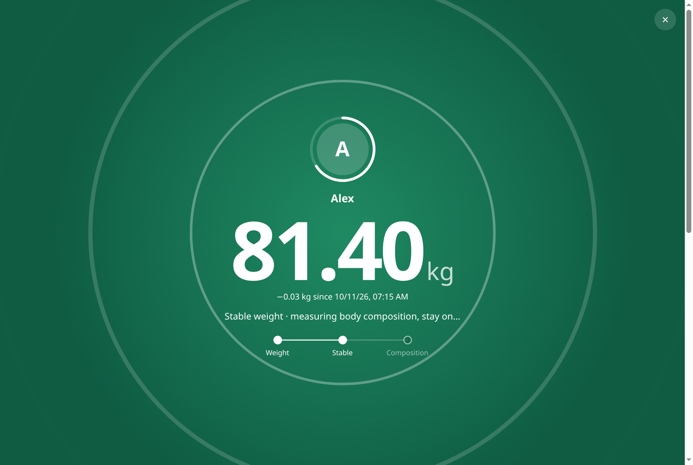
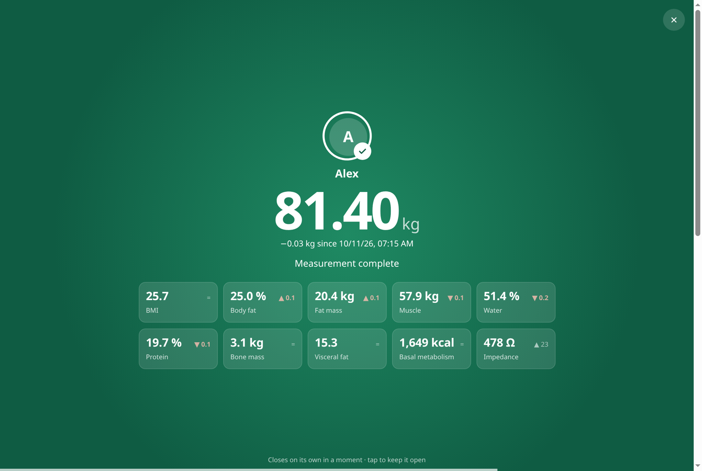
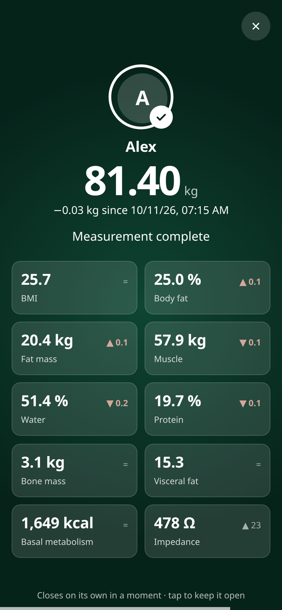
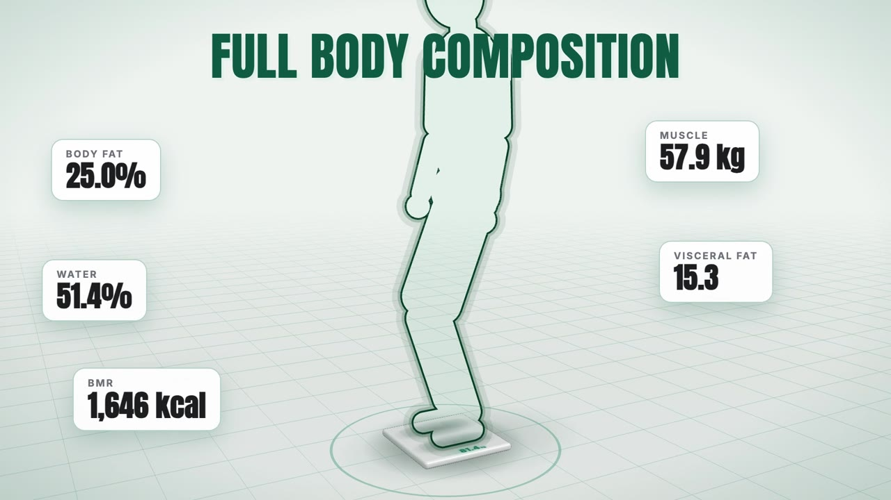
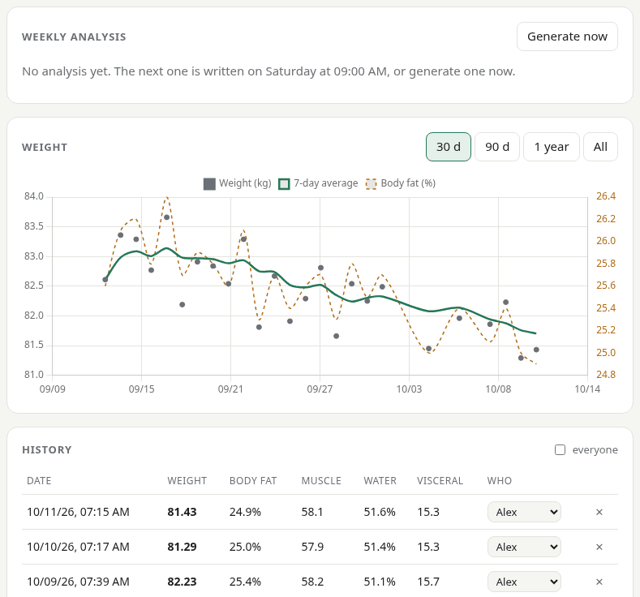

# Mi Scale Dashboard

A self-hosted, local-first dashboard for the **Xiaomi Mi Body Composition Scale 2**. A small
server near the scale listens for its Bluetooth Low Energy broadcasts. Each weigh-in shows up
live in your browser, gets matched to the right person, and is saved with its body
composition. No Xiaomi account, no Zepp Life app, no cloud.

[Português (Brasil)](README.pt-BR.md)



| Dashboard (light) | Dashboard (dark) |
| --- | --- |
|  |  |

| Weigh-in: stable weight | Weigh-in: body composition | Phone |
| --- | --- | --- |
|  |  |  |

All data in the screenshots is made up (`scripts/seed_demo.py`), and Alex's photo is
AI-generated, not a real person ([docs/demo](docs/demo/README.md)).

## Live demo

Try it at **<https://brorlandi.github.io/miscale-dashboard/>**. It is the same dashboard
running entirely in your browser, with made-up data for two fictional people. It needs no
scale, no Bluetooth and no server. Press **▶ Play demo** to watch a weigh-in from start to
finish; the tour ends with Alex's weekly analysis being written in its card. That text is
simulated (fixed sentences filled in with the demo's numbers), since the demo has no AI behind
it. Changes you make stay in the page and are gone when you reload it.

## Promo video

[](https://youtu.be/ajvoJN0Qh_4)

**[▶ Watch the promo video on YouTube](https://youtu.be/ajvoJN0Qh_4)**: 40 seconds, 1920x1080, with music.
It is built with code, like the rest of the repository: the 3D scenes, the recordings of the
live demo and the soundtrack are all generated from [video/](video/README.md).

## Features

- **Live weigh-in screen.** When someone steps on the scale, every open browser shows the
  weight as it settles, then locks it in. A few seconds later it shows the bioimpedance
  results (body fat, muscle, water, protein, bone mass, visceral fat, BMR). The screen then
  closes and the dashboard updates with animation.
- **Multiple profiles.** Each weigh-in goes to the person whose last weight is closest,
  within a tolerance you set. Anything that doesn't match is saved as "unknown", and you can
  assign it later from the history. Profiles can have photos.
- **Body composition** from impedance, using the open formulas from openScale. Arrows show
  the change since the previous weigh-in, 7 days ago or 30 days ago, colored green or red by
  whether that change is good or bad.
- **Chart and history:** weight with a 7-day moving average and body fat, for 30 days, 90
  days, a year or all time.
- **Notifications (optional)** for every weigh-in, through a generic JSON webhook or your
  own Telegram bot.
- **AI weekly analysis (optional).** Once a week an AI model of your choice (OpenAI,
  OpenRouter, or a local Ollama) reads the week's numbers and writes a short summary: what
  improved, what needs attention, and what to try next week. It is typed into the dashboard
  live as the model writes it, and goes out with the notifications.
- English and Portuguese (Brazil); kg or lb; light, dark or automatic theme.
- **Installable on your phone** as an app (PWA), with offline shell.
- One container, SQLite, no external services. Chart.js is bundled, so it works offline.

## What you need

### 1. The scale

**Xiaomi Mi Body Composition Scale 2**, model **XMTZC05HM**. It advertises as `MIBFS`.

Where to buy it in Brazil: [Amazon](https://amzn.to/3TPrsph) or
[Mercado Livre](https://meli.la/2XoPtSb). These are affiliate links: as an Amazon Associate
and a Mercado Livre affiliate, I earn from qualifying purchases, at no extra cost to you.

The older **Mi Smart Scale 2 (XMTZC04HM)** and other models use a different packet format
and aren't supported yet. If you have one, a pull request is welcome; see
[Contributing](#contributing).

### 2. A computer with Bluetooth Low Energy, near the scale

This is a hard requirement. The server **must have a BLE-capable Bluetooth adapter** and be
within Bluetooth range of the scale, usually the same room or the one next to it. The scale
doesn't pair or connect to anything: it only broadcasts while someone is standing on it, and
the server has to hear those broadcasts directly.

Hardware known to work, or that should work:

- Raspberry Pi 3, 4, 5 or Zero 2 W (built-in Bluetooth)
- Mini PCs and NUCs with an Intel Wi-Fi + Bluetooth card (AX200, AX201, AX210...). It was
  developed on an Intel N100 with an AX201.
- Any Linux machine with a USB Bluetooth 4.0+ dongle

The supported setup is **Linux with BlueZ** (the standard Bluetooth stack on Ubuntu, Debian
and Raspberry Pi OS). The Docker container talks to the host's BlueZ over D-Bus. The scanner
is built on [bleak](https://github.com/hbldh/bleak), so macOS and Windows may work when you
run it without Docker, but they aren't tested.

Check that the host can see Bluetooth LE devices:

```bash
bluetoothctl show            # should list a controller with "Powered: yes"
sudo bluetoothctl scan le    # step on the scale: a device named MIBFS should appear
```

## Install with Docker (recommended)

```bash
git clone https://github.com/BrOrlandi/miscale-dashboard.git
cd miscale-dashboard
cp .env.example .env          # optional settings, see below
docker compose up -d --build
```

Open `http://<server-ip>:8800`. Create a profile with your height, birth date and sex, then
step on the scale barefoot and wait for it to finish.

The compose file does three things the scanner needs:

```yaml
volumes:
  - ./data:/data                  # database and profile photos
  - /run/dbus:/run/dbus:ro        # talk to the host's BlueZ
security_opt:
  - apparmor=unconfined           # Docker's AppArmor profile blocks D-Bus
```

It doesn't need `privileged` or `network_mode: host`. On hosts without AppArmor (most
Raspberry Pi OS installs), the `security_opt` line is harmless.

## Install without Docker

Python 3.11+ on a Linux host with BlueZ:

```bash
git clone https://github.com/BrOrlandi/miscale-dashboard.git
cd miscale-dashboard
python3 -m venv .venv && . .venv/bin/activate
pip install -r requirements.txt
MISCALE_DB=./data/miscale.db uvicorn app.main:app --host 0.0.0.0 --port 8800
```

To run it as a service, use a systemd unit like this one:

```ini
# /etc/systemd/system/miscale-dashboard.service
[Unit]
Description=Mi Scale Dashboard
After=bluetooth.target network-online.target

[Service]
WorkingDirectory=/opt/miscale-dashboard
Environment=MISCALE_DB=/opt/miscale-dashboard/data/miscale.db
ExecStart=/opt/miscale-dashboard/.venv/bin/uvicorn app.main:app --host 0.0.0.0 --port 8800
Restart=always

[Install]
WantedBy=multi-user.target
```

## Install it on your phone

The dashboard is a Progressive Web App: it installs like an app, opens full screen with its
own icon, and the shell loads even when the server is unreachable.

- **Android / Chrome / Edge:** an "Install app" button appears in the header (or use the
  browser menu › *Install app*).
- **iPhone / iPad (Safari):** a hint shows up once: tap Share, then *Add to Home Screen*.

Browsers only allow installing (and run the service worker) over **HTTPS**, so serve the
dashboard through a reverse proxy with a certificate (Caddy, Traefik, nginx), or with
`tailscale serve`. On plain `http://<ip>:8800` it works normally in the browser, and iOS can
still add it to the home screen, but Android won't offer to install it.

## Configuration

Every setting is optional and set through environment variables (`.env` with Docker). The
unit, the language and the tolerance for recognizing people are changed in the web UI.

| Variable | Default | What it does |
| --- | --- | --- |
| `TZ` | `UTC` | Timezone used for measurement times |
| `MISCALE_SCALE_MAC` | empty | Only accept this scale. Empty accepts any XMTZC05HM in range (useful if a neighbor has one too) |
| `MISCALE_DB` | `/data/miscale.db` | SQLite database path; photos go in `photos/` next to it |
| `MISCALE_LANG` | `en` | Language of notifications: `en` or `pt-BR` |
| `MISCALE_PUBLIC_URL` | empty | Dashboard link appended to notifications |
| `MISCALE_WEBHOOK_URL` | empty | POST a JSON message for every weigh-in |
| `MISCALE_TELEGRAM_TOKEN` | empty | Bot token from [@BotFather](https://t.me/BotFather) |
| `MISCALE_TELEGRAM_CHAT_ID` | empty | Chat that receives the messages |
| `MISCALE_NOTIFY_WAIT` | `25` | Seconds to wait for the impedance before notifying |
| `MISCALE_AI_API_KEY` | empty | Turns on the [AI weekly analysis](#ai-weekly-analysis-optional) |
| `MISCALE_AI_BASE_URL` | `https://api.openai.com/v1` | Any OpenAI-compatible API |
| `MISCALE_AI_MODEL` | `gpt-5.4-mini` | Model, or a comma-separated list tried in order |
| `MISCALE_AI_ENABLED` | empty | `true` turns the analysis on without a key (local Ollama) |
| `MISCALE_AI_WEEKDAY` / `MISCALE_AI_HOUR` | `5` / `9` | When the weekly analysis runs (0 = Monday; default Saturday 9:00) |
| `MISCALE_AI_LANG` | `MISCALE_LANG` | Language of the analysis: `en` or `pt-BR` |
| `MISCALE_SCANNER` | `on` | `off` disables Bluetooth (development and demos) |
| `MISCALE_LOG_LEVEL` | `INFO` | Python log level |

### Finding your scale's address

Step on the scale and open `http://<server>:8800/api/debug/devices`. Every device the
adapter has seen is listed; the scale is the one named `MIBFS` with service data
`0000181b-...`. Put its address in `MISCALE_SCALE_MAC`. `/api/debug/packets` shows the last
raw packets received from it.

### Notifications

When a weigh-in finishes, the server waits up to `MISCALE_NOTIFY_WAIT` seconds for the
impedance, then sends a message like this. Weigh-ins that match no profile (an object on the
scale, a pet) are not notified; they only show up in the history.

```
⚖️ Alex · 81.40 kg
−0.03 kg since Oct 11 07:15 · 7-day average 81.7 kg
Body fat 25.0% (20.4 kg) · Muscle 57.9 kg
Water 51.4% · Protein 19.7% · Bone 3.1 kg
BMI 25.7 · Visceral fat 15 · BMR 1,649 kcal
Impedance 478 Ω
```

The webhook receives the same text plus the raw data, so you can use it from n8n, Node-RED,
Home Assistant (`/api/webhook/<id>`) or anything else that accepts JSON:

```json
{
  "event": "measurement",
  "text": "⚖️ Alex · 81.40 kg\n...",
  "message": "⚖️ Alex · 81.40 kg\n...",
  "profile": { "id": 1, "name": "Alex" },
  "measurement": { "id": 42, "measured_at": "2026-10-12T07:15:03", "weight_kg": 81.4, "impedance": 478, "metrics": { "body_fat": 25.0, "...": "..." } }
}
```

## AI weekly analysis (optional)



Once a week, the server sends each person's numbers to a language model and shows its
answer in a "Weekly analysis" card: a short summary of the week, then *What improved*,
*What needs attention* and *For next week*. The model is told to look at averages and trends
rather than single readings, to say when there are too few weigh-ins, and to stay away from
medical advice. The text appears in every open browser as the model writes it, is saved in
the database, and is sent through the [notifications](#notifications) when they are set up.
"Generate now" writes one on demand for the last 7 days.

It is off by default. Without a key the card only explains how to turn it on, and nothing
leaves your network. It works with any OpenAI-compatible chat API:

```bash
# OpenAI
MISCALE_AI_API_KEY=sk-...
# MISCALE_AI_MODEL=gpt-5.4-mini           (the default)

# OpenRouter: any model it offers; a comma-separated list falls back in order
MISCALE_AI_API_KEY=sk-or-...
MISCALE_AI_BASE_URL=https://openrouter.ai/api/v1
MISCALE_AI_MODEL=openai/gpt-5.4-mini,openai/gpt-5.4-nano

# Ollama on your own machine: no key and nothing leaves your network
MISCALE_AI_ENABLED=true
MISCALE_AI_BASE_URL=http://192.168.1.10:11434/v1
MISCALE_AI_MODEL=llama3.2
```

LM Studio, llama.cpp's server, vLLM and the like work the same way with their own base URL.
The analysis runs every Saturday at 9:00 for everyone who weighed in that week (change it
with `MISCALE_AI_WEEKDAY` and `MISCALE_AI_HOUR`; if the server is off then, it catches up
within two days). It is written in `MISCALE_AI_LANG`, which defaults to `MISCALE_LANG`.

**Cost.** One analysis is a single request of a few thousand tokens, so with a small model
like `gpt-5.4-mini` a year of weekly analyses for two people costs about a dollar. A local
model costs nothing.

**Privacy.** The provider receives the week's weigh-ins and body composition, the weekly
averages of the last 8 weeks, and the person's first name, age, height and sex. Nothing else
is sent. If you'd rather keep everything at home, use Ollama or another local server.

The webhook gets the analysis with `"event": "analysis"`:

```json
{
  "event": "analysis",
  "text": "🧠 Weekly analysis · Alex (Oct 4 – Oct 10)\n\nYour weight ...",
  "message": "🧠 Weekly analysis · Alex (Oct 4 – Oct 10)\n\nYour weight ...",
  "profile": { "id": 1, "name": "Alex" },
  "analysis": { "id": 7, "week_start": "2026-10-04", "week_end": "2026-10-10", "kind": "weekly", "model": "gpt-5.4-mini", "text": "..." }
}
```

## Using it

- **Profiles:** "+ Person" creates one. Height, birth date and sex are needed for body
  composition. The approximate weight is only used to recognize the person's first weigh-in;
  after that, their last weight is used.
- **Weighing:** step on barefoot and stay on until the impedance is measured, about 3 to 5
  seconds after the weight stabilizes. With socks or shoes on you only get the weight.
- **Wrong person?** Change it in the history; the body composition is recalculated for the
  new profile. Editing a profile's height or birth date recalculates their whole history.
- **Accuracy:** bioimpedance is an estimate that shifts with hydration, meals and time of
  day. Weigh yourself at the same time every day and watch the trend, not single readings.
  This is not a medical device.

## Security

The dashboard has **no login**. Run it on your home network only, or put it behind a reverse
proxy with authentication (Traefik, Caddy or nginx with basic auth, Authelia, Tailscale...)
before exposing it anywhere. The proxy must forward WebSockets (`/ws`).

## How it works

The scale needs no connection. While someone stands on it, it advertises the Bluetooth
**Body Composition service (`0x181B`)** with 13 bytes of service data:

| Bytes | Meaning |
| --- | --- |
| 0 | Control: bit 0 = pounds |
| 1 | Control: bit 1 = has impedance, bit 5 = stabilized, bit 6 = invalid date, bit 7 = person stepped off |
| 2–3 | Year (little endian) |
| 4–8 | Month, day, hour, minute, second |
| 9–10 | Impedance in ohms (`0xfffe` while still measuring) |
| 11–12 | Weight (little endian; ÷200 for kg, ÷100 for lb) |

A weigh-in is a stream of packets. First the weight settles, then the stabilized weight
arrives, then the same packet again with the impedance. The scale keeps repeating the result
for a while after the person steps off. Its clock ticks on every packet, so the server
groups packets into one measurement by weight (±0.1 kg) and arrival time (3 minutes), not by
the scale's timestamp.

```
app/
  scale.py      BLE scanner (bleak) and packet parser
  session.py    groups packets into measurements, picks the profile
  body.py       body composition formulas
  db.py         SQLite
  notify.py     webhook and Telegram
  analysis.py   optional AI weekly analysis (any OpenAI-compatible API)
  main.py       FastAPI app, REST API and WebSocket
  static/       the dashboard (one HTML file, no build step)
```

The REST API is documented at `/docs` (OpenAPI). The browser gets live packets, new
measurements and the weekly analysis (piece by piece, as the model writes it) over the `/ws`
WebSocket.

## Development

You don't need the scale or Bluetooth to work on the dashboard:

```bash
pip install -r requirements-dev.txt
python -m scripts.seed_demo data/demo.db        # two fictional people, 90 days of data
MISCALE_DB=data/demo.db MISCALE_SCANNER=off uvicorn app.main:app --reload --port 8800

# play a fake weigh-in in every open browser (nothing is saved)
curl -X POST 'localhost:8800/api/debug/simulate?weight=81.4&impedance=478'

pytest
ruff check .
```

The live demo is a static build of the same page with an in-memory backend
(`demo/demo.js`) in place of the server:

```bash
python scripts/build_demo.py                     # writes site/
python -m http.server -d site 8000               # open http://localhost:8000/
```

`.github/workflows/pages.yml` publishes it to GitHub Pages. It only runs by hand from the
Actions tab, and the comment at the top of the file explains how to turn Pages on.

## Contributing

Issues and pull requests are welcome. Support for more scales is especially welcome, and so
are translations and packaging (Home Assistant add-on, prebuilt images). See
[CONTRIBUTING.md](CONTRIBUTING.md). When reporting a problem with readings, include the
output of `/api/debug/packets` from a weigh-in.

## Credits

- Body composition formulas from [openScale](https://github.com/oliexdev/openScale) and the
  `body_metrics` module of [wiecosystem/Bluetooth](https://github.com/wiecosystem/Bluetooth),
  which reproduce the numbers of Xiaomi's app.
- Packet format documented by the openScale and
  [xiaomi_mi_scale](https://github.com/lolouk44/xiaomi_mi_scale) projects.
- [bleak](https://github.com/hbldh/bleak), [FastAPI](https://fastapi.tiangolo.com/) and
  [Chart.js](https://www.chartjs.org/) (MIT, bundled in `app/static/vendor`).

Not affiliated with or endorsed by Xiaomi.

## License

[MIT](LICENSE)
